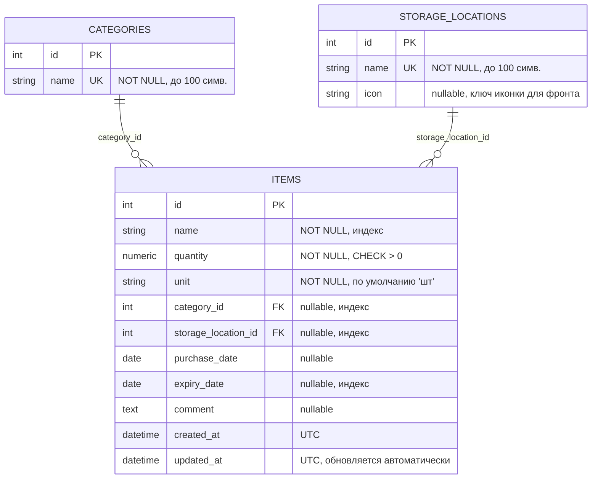

# База данных «Запасы»

SQLAlchemy 2.0, по умолчанию SQLite (`pantry.db`), для PostgreSQL достаточно переменной `DATABASE_URL`.

## Быстрый старт

```bash
pip install -r requirements.txt pytest
python -m app.init_db              # создать таблицы
python -m app.seed                 # справочники + 6 позиций из макета
python -m app.seed --extended      # + 15 позиций для проверки фильтров, сортировки, граничных случаев
python -m app.seed --bulk 1000     # + 1000 позиций для проверки производительности
python -m app.seed --reset         # пересоздать таблицы
python -m app.demo_queries         # напечатать результаты запросов на текущей БД
pytest                             # 48 тестов
```

## Структура проекта

```
app/
  database.py              подключение, сессия, get_db для FastAPI
  models/
    stock_item.py          StockItem: позиция запаса, статусы, SQL-условия поиска/фильтра/сортировки
    category.py            Category
    storage_location.py    StorageLocation
  queries.py               готовые запросы для backend (список, фильтры, сортировка, статистика, справочники)
  init_db.py               создание таблиц
  seed.py                  тестовые данные
  demo_queries.py          наглядный вывод запросов
tests/                     test_models.py, test_queries.py, test_integrity.py
```

## ER-диаграмма



Модель `StockItem` хранится в таблице `items`. Связи «один ко многим»: у категории и у места хранения много позиций, у позиции категория и место необязательны.

## Таблица `items` (модель `StockItem`)

| Поле | Тип | Ограничения |
|---|---|---|
| id | INTEGER | PK |
| name | VARCHAR(255) | NOT NULL, не пустое, индекс |
| quantity | NUMERIC(10,2) | NOT NULL, `> 0` |
| unit | VARCHAR(16) | NOT NULL, по умолчанию `шт` |
| category_id | FK → categories.id | nullable, `ON DELETE RESTRICT`, индекс |
| storage_location_id | FK → storage_locations.id | nullable, `ON DELETE RESTRICT`, индекс |
| purchase_date | DATE | nullable |
| expiry_date | DATE | nullable, индекс |
| comment | TEXT | nullable (пустая строка сохраняется как NULL) |
| created_at / updated_at | DATETIME | UTC, заполняются автоматически |

Ограничения на уровне БД: `quantity > 0`; название не пустое; `expiry_date >= purchase_date`, если указаны обе даты.
Пробелы по краям в `name`, `unit`, `comment` и названиях справочников убираются автоматически.

## Запросы (`app/queries.py`)

| Функция | Что делает |
|---|---|
| `list_items(db, q, category_id, storage_location_id, status, sort, order, limit, offset)` | главный запрос списка: поиск + фильтры + сортировка + постраничность |
| `count_items(db, ...те же фильтры)` | сколько позиций подходит (для «6 из 6») |
| `get_items_by_category(db, category_id)` | позиции категории |
| `get_items_by_storage_location(db, storage_location_id)` | позиции места хранения |
| `get_items_by_category_and_location(db, category_id, storage_location_id)` | и то и другое сразу |
| `get_stats(db)` | `{total, fresh, expiring_soon, expired, no_date}` для карточек сверху, один запрос |
| `list_categories_with_counts(db)`, `list_storage_locations_with_counts(db)` | справочники с количеством позиций (пустые тоже) |
| `find_category_by_name(db, name)`, `find_storage_location_by_name(db, name)` | поиск без учёта регистра, чтобы не создать дубль «молочные» и «Молочные» |

Все функции принимают дополнительные параметры (`sort`, `order`, `limit` и т. д.), а позиции возвращаются сразу с загруженными категорией и местом хранения (без лишних запросов).

### Сортировка

- `sort="name"`: по названию без учёта регистра, «ё» = «е». Без этого в SQLite «Яблоки» оказались бы раньше «апельсины», а «Мёд» после «Молоко».
- `sort="expiry"`: по сроку годности. Позиции без срока **всегда в конце**, и при `order="asc"`, и при `order="desc"`. При равных значениях порядок по названию.
- `order="asc" | "desc"`. Неизвестные значения вызывают `ValueError` (в роуте превратите в 422).

### Пример для FastAPI

```python
from fastapi import Depends, HTTPException
from sqlalchemy.exc import IntegrityError
from sqlalchemy.orm import Session

from app import queries as q
from app.database import get_db
from app.models import Category, ExpiryStatus


@app.get("/items")
def get_items(q_text: str | None = None, category_id: int | None = None,
              storage_location_id: int | None = None, status: ExpiryStatus | None = None,
              sort: str = "name", order: str = "asc", db: Session = Depends(get_db)):
    return q.list_items(db, q=q_text, category_id=category_id, storage_location_id=storage_location_id,
                        status=status, sort=sort, order=order)


@app.get("/stats")
def get_stats(db: Session = Depends(get_db)):
    return q.get_stats(db)


@app.delete("/categories/{category_id}", status_code=204)
def delete_category(category_id: int, db: Session = Depends(get_db)):
    category = db.get(Category, category_id)
    if not category:
        raise HTTPException(404, "Категория не найдена")
    try:
        db.delete(category)
        db.commit()
    except IntegrityError:
        db.rollback()
        raise HTTPException(409, "Нельзя удалить категорию: в ней есть продукты")
```

В Pydantic-схеме ответа включите `model_config = ConfigDict(from_attributes=True)`: тогда `status`, `status_label` и `days_left` попадут в ответ как обычные поля.

## Тестовые данные (`python -m app.seed --extended`)

21 позиция, даты считаются от сегодняшнего дня. Итого: Годен 11, Скоро истекает 4, Просрочено 3, Срок не указан 3.

| Категория | Позиции | Место хранения | Позиции |
|---|---|---|---|
| Молочные продукты | 5 | Холодильник | 8 |
| Хлебобулочные изделия | 2 | Кухонный шкаф | 8 |
| Крупы и макароны | 3 | Морозильная камера | 4 |
| Фрукты и овощи | 4 | Балкон (пустое) | 0 |
| Бакалея | 3 | без места хранения | 1 (Консервы) |
| Мясо и рыба | 3 | | |
| Напитки (пустая) | 0 | | |
| без категории | 1 (Мёд) | | |

Граничные случаи: Сыр (срок сегодня, 0 дней), Яблоки (ровно 3 дня), Сметана (4 дня: уже «Годен»), Творог (просрочен вчера), «апельсины» с маленькой буквы (сортировка), «Мёд» (поиск «мед»), «Молоко» и «Молоко кокосовое» в разных категориях (поиск).

## Принятые решения

1. **Статус и «дней до окончания» в БД не хранятся**, считаются от текущей даты (`item.status`, `item.status_label`, `item.days_left`). Правила: больше 3 дней — `fresh`, от 0 до 3 включительно — `expiring_soon`, меньше 0 — `expired`, нет даты — `no_date`.
2. **Удаление категории или места, к которым привязаны позиции, запрещено** (`RESTRICT`). БД выбросит `IntegrityError`, API отвечает 409. Если команда выберет `SET NULL`, меняется в `stock_item.py` и убирается `passive_deletes="all"` в моделях справочников.
3. **Внешние ключи в SQLite** включаются при каждом подключении (по умолчанию они выключены).
4. **Поиск и сортировка по кириллице**: в SQLite встроенные `lower()` и `LIKE` понимают только латиницу, поэтому в `database.py` подключена Unicode-версия `lower()`.
5. **Единицы измерения** хранятся строкой, допустимые значения лучше ограничить в Pydantic-схеме.
6. **Время** хранится в UTC, «сегодня» для статусов берётся по дате сервера.
7. **Миграции**: сейчас `create_all`; при частых изменениях схемы подключить Alembic.

## Что проверено тестами (48 штук)

- **Модели и связи**: поля, значения по умолчанию, автообновление `updated_at`, уникальность названий справочников, очистка пробелов.
- **Ограничения БД**: пустое название, количество 0 и меньше, срок раньше даты покупки, несуществующая категория или место.
- **Статусы**: границы (−1, 0, 3, 4 дня, нет даты); SQL-фильтр даёт тот же результат, что Python-свойство.
- **Запросы**: по категории, по месту, по обоим, пустые и несуществующие справочники, позиции без категории или места, поиск, фильтр по статусу, комбинации фильтров, постраничность, статистика.
- **Сортировка**: по названию (регистр, «ё»), по сроку по возрастанию и убыванию (без срока в конце), совместно с фильтрами, неверные параметры.
- **Целостность**: создание со связями, перенос позиции между категориями, переименование категории, неудачное изменение не портит данные, удаление позиции не затрагивает остальные и справочники, удаление используемой категории или места блокируется, освобождённую категорию удалить можно, данные сохраняются после перезапуска (файловая БД).
- **Производительность**: 1000 позиций, список + поиск + фильтр + сортировка + статистика быстрее 2 секунд.

## Что нужно решить команде

- **Дата приобретения**: в макете со звёздочкой, в ТЗ не обязательна. В БД необязательная; обязательность делается в схеме FastAPI.
- **Иконки продуктов** в БД не хранятся. Если пользователь выбирает их сам, нужно поле `icon` в `items`.
- **Названия статусов**: в UI Kit «Свежий / Просрочен», в ТЗ «Годен / Просрочено». В моделях названия из ТЗ.
